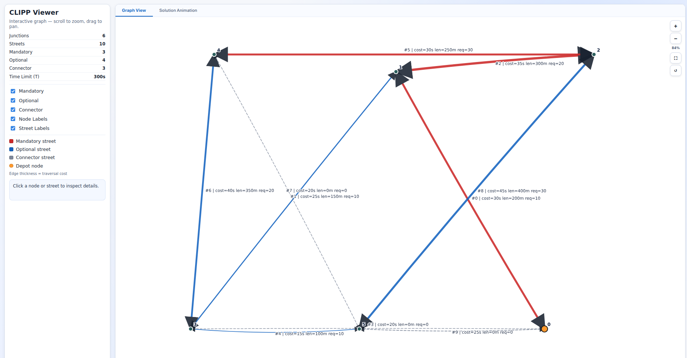

# CLIPP-ORTOOL

**MILP solver for the Climate-Integrated Street Cleaning Routing Problem (CLIPP)** using Google OR-Tools CP-SAT.

Given a city street network, a fleet of heterogeneous cleaning vehicles, and a time budget, the solver plans routes that **maximise total length of streets cleaned** while **minimising water waste** — ensuring all mandatory streets are covered and every vehicle returns to the depot.

## Quick Start

```bash
# Install dependencies
pip install -r requirements.txt

# Run the solver
python clipp_solver.py Instances/toy.txt --time_limit 60 --num_workers 4
```

### CLI Arguments


| Argument        | Default                     | Description                         |
| --------------- | --------------------------- | ----------------------------------- |
| `input_file`    | *(required)*                | Path to instance`.txt` file         |
| `--time_limit`  | 600                         | Solver time limit in seconds        |
| `--num_workers` | 4                           | Parallel solver workers (CPU cores) |
| `--output`      | `<input_stem>_solution.txt` | Output file path                    |

## Problem Overview

- **Multiple vehicles** with different capacities: Small (10 L/km), Medium (20 L/km), Large (30 L/km)
- **Three street categories**: Mandatory (must clean), Optional (extra coverage), Connector (traversal only)
- **Capacity matching**: A vehicle can only clean a street if its capacity meets the street's requirement
- **Water waste penalty**: Using a large vehicle on a light street wastes water — the objective penalises this
- **Time budget**: Every vehicle must complete its route within T seconds

**Objective**: `Score = Total length cleaned − W × Total water wasted`

## How It Works

### Solver Pipeline

```
Parse instance → Build directed graph → Dijkstra reachability check
    → Build MILP → Iterative solve (with subtour elimination)
    → Reconstruct Eulerian routes → Validate → Score → Write output
```

## Instance Format

```
N M T C S [W]           ← header: junctions, streets, time limit, vehicles, depot, [waste penalty]
[x y]                   ← optional: N lines of junction coordinates
A B D cost length cat req   ← M street lines
type1 type2 ...         ← C vehicle types (S/M/L)
```

**Example** (`Instances/toy.txt`):

```
6 10 300 3 0
0 1 2 30 200 M 10
1 3 2 25 150 O 10
1 2 2 35 300 M 20
0 3 1 20 0 C 0
...
S M L
```

**Street fields**: `A B` = endpoints, `D` = direction (1=one-way, 2=two-way), `cost` = traversal time (s), `length` = metres, `cat` = M/O/C, `req` = cleaning requirement (L/km).

## Project Structure

```
├── clipp_solver.py          # Self-contained solver (single file, 921 lines)
├── main.py                  # Same solver using modular imports from clipp/
├── check_feasibility.py     # Standalone feasibility checker for solutions
├── visualize_instance.py    # Interactive graph visualization (HTML output)
│
├── clipp/                   # Modular solver package
│   ├── parser.py            #   Instance file parsing
│   ├── graph.py             #   Arc construction, Dijkstra, graph utilities
│   ├── model.py             #   CP-SAT MILP formulation & subtour elimination
│   ├── reconstruction.py    #   Hierholzer's algorithm, connectivity repair
│   ├── validator.py         #   Solution feasibility checking
│   ├── scoring.py           #   Objective function evaluation
│   └── io.py                #   Solution file output
│
├── Instances/               # Problem instances & solutions
│   ├── toy.txt              #   Small test instance (6 junctions, 10 streets)
│   ├── A_instance_V2.txt    #   Medium instance
│   └── B_instance.txt       #   Larger instance
│
└── docs/
    ├── problem_statement/   # Official CLIPP problem description
    ├── formulation/         # LaTeX formulation, MILP explanation (markdown)
    └── papers/              # Related literature & research papers
```

## Output Format

The solver writes one solution file with 3 lines per vehicle:

```
C                           ← number of vehicles
n                           ← streets traversed count
j0 j1 j2 ... jn            ← junction sequence (depot → ... → depot)
s0 s1 s2 ...               ← street indices cleaned (may be empty)
```

## Other Scripts

### `check_feasibility.py`

Validates an existing solution file against the instance rules (depot start/end, time budget, capacity, mandatory coverage).

### `visualize_instance.py`


Generates an interactive HTML graph of the street network, colour-coded by category.



https://github.com/user-attachments/assets/25d7d303-8517-45b0-9540-60a0d6b0dfaa


## Requirements

- Python 3.9+
- [Google OR-Tools](https://developers.google.com/optimization) (`pip install ortools`)
